# Answers: Resume CRUD Lab (68160053)

## Task 1-3: SQL ที่เติม (ทุกคำสั่งใช้ prepared statement)

| Task | ไฟล์ | SQL | bind |
|---|---|---|---|
| 1 INSERT | `skill_create.php` | `INSERT INTO skill (profile_id, skill_name, skill_level) VALUES (?, ?, ?)` | `iss` = profile_id, name, level |
| 2a SELECT | `skill_edit.php` | `SELECT skill_name, skill_level FROM skill WHERE id = ? AND profile_id = ?` | `ii` = id, profile_id |
| 2b UPDATE | `skill_edit.php` | `UPDATE skill SET skill_name = ?, skill_level = ? WHERE id = ? AND profile_id = ?` | `ssii` = name, level, id, profile_id |
| 3 DELETE | `skill_delete.php` | `DELETE FROM skill WHERE id = ? AND profile_id = ?` | `ii` = id, profile_id |

## Task 4: ทำไม UPDATE และ DELETE ต้องมี WHERE

`UPDATE` / `DELETE` ที่ไม่มี `WHERE` จะมีผลกับ **ทุกแถว** ในตาราง

```sql
DELETE FROM skill;                          -- ลบทุก skill ของทุกคน
UPDATE skill SET skill_level = 'Beginner';  -- เปลี่ยนระดับของทุกแถว
```

เงื่อนไข `WHERE id = ? AND profile_id = ?` ทำให้คำสั่งแตะได้ **แค่ 1 แถว** ที่เป็นของ profile นี้เท่านั้น
`id` ระบุแถว และ `profile_id` กันไม่ให้แก้หรือลบแถวของ profile อื่น แม้ใครจะส่ง id ของคนอื่นมา

## Task 4: การทำ parameter binding

เทียบการต่อสตริงกับ prepared statement สมมติผู้โจมตีส่ง `id = "1 OR 1=1"`

```php
// ไม่ปลอดภัย: ต่อค่าจากผู้ใช้เข้า SQL ตรง ๆ
$sql = "DELETE FROM skill WHERE id = " . $_GET['id'];
// ได้ SQL จริง: DELETE FROM skill WHERE id = 1 OR 1=1   -> ลบทุกแถว

// ปลอดภัย: ใช้ placeholder + bind (ที่ใช้ใน skill_delete.php)
$stmt = mysqli_prepare($conn, 'DELETE FROM skill WHERE id = ? AND profile_id = ?');
mysqli_stmt_bind_param($stmt, 'ii', $id, $pid);
mysqli_stmt_execute($stmt);
// ค่าถูกส่งแยกจากตัวคำสั่ง MySQL มองเป็น "ข้อมูล" เสมอ ไม่ใช่ "โค้ด SQL"
```

ชั้นป้องกันอื่นในโปรเจกต์: `valid_id()` ตรวจว่าเป็นจำนวนเต็ม >= 1, ระดับ skill ต้องอยู่ในรายการที่อนุญาต
(`in_array(..., true)`), การเปลี่ยนข้อมูลใช้ POST + CSRF token, และใช้ `h()` (htmlspecialchars) escape ตอนแสดงผล

## Task 5: Git workflow

- `main` = starter ของอาจารย์ที่เอา `.env` และ `secret/` ออกแล้ว
- ทำงานบน branch `feature/complete-crud-sql` แล้วรวมกลับ `main`
- commit แยกตามงาน: ความลับ/`.gitignore`, การตั้งค่า DB, INSERT, SELECT+UPDATE, DELETE, เก็บกวาด, ธีม UI, เอกสาร
- **ไม่มีความลับใน Git**: `.gitignore` กัน `.env`, `.env.*` และ `secret/*` มีเฉพาะ `.env.example` กับ
  `secret/config.example.php` ที่เป็นค่าตัวอย่าง รหัสผ่านจริงอยู่ในไฟล์ `secret/config.php` บนเซิร์ฟเวอร์เท่านั้น

## ข้อจำกัดที่ทราบ (Security)

- หน้า CRUD ยัง**ไม่มีระบบล็อกอิน** ตามที่ README ของอาจารย์ระบุว่าเป็นตัวอย่างในห้องเรียน
  ถ้านำขึ้นเว็บจริงต้องเพิ่มการยืนยันตัวตน/สิทธิ์ก่อน
- ห้าม import `database/setup.sql` ลงฐานที่มีข้อมูลจริง เพราะมี `DROP TABLE` ของ `profile`, `education`, `skill`, `training`

## Testing (screenshots)

ทดสอบบน XAMPP (Apache + MariaDB) ที่ `http://localhost/resume_crud_lab/` ใช้ฐานฝึก `resume_lab`
ที่ import จาก `database/setup.sql` (ไม่ใช่ฐานข้อมูลเรซูเม่จริง)

| # | ขั้นตอน | ภาพ |
|---|---|---|
| 1 | รายการ skill เริ่มต้น (3 แถว) | 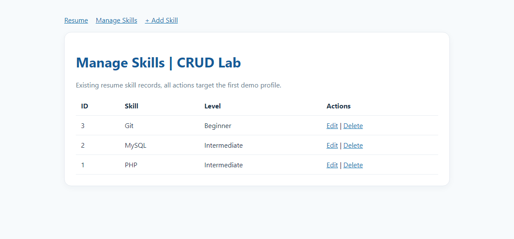 |
| 2 | ฟอร์มเพิ่ม skill (มี CSRF token) | 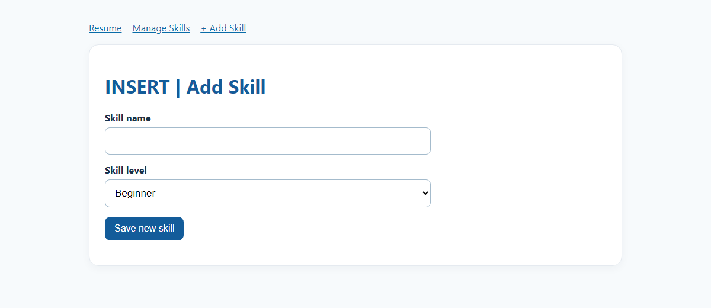 |
| 3 | **INSERT**: เพิ่ม `Test Skill` แล้วแถวใหม่ขึ้นในตาราง | 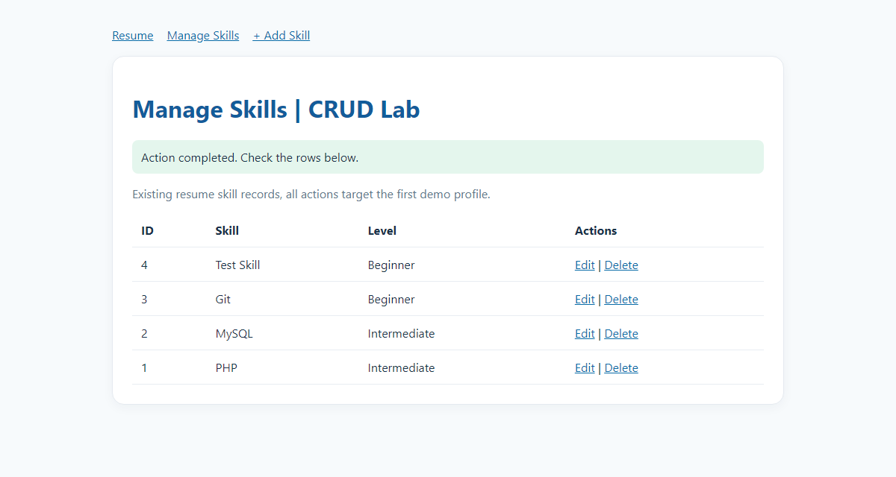 |
| 4 | **SELECT**: หน้า Edit ดึงค่าเดิมของแถวมาใส่ฟอร์ม | 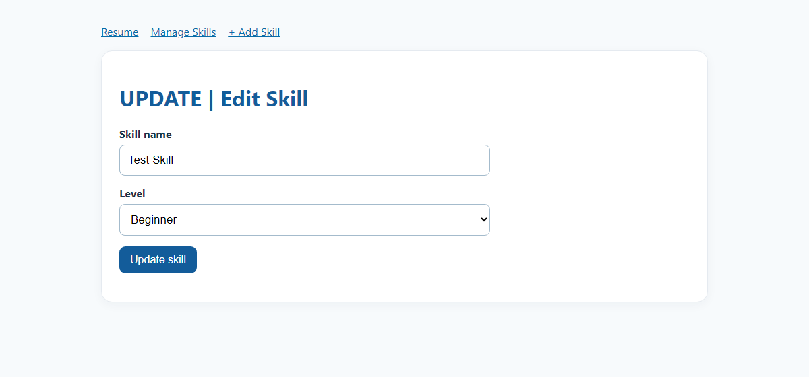 |
| 5 | **UPDATE**: เปลี่ยนระดับเป็น Advanced แล้วค่าใหม่ขึ้นในตาราง |  |
| 6 | หน้ายืนยันก่อน **DELETE** | 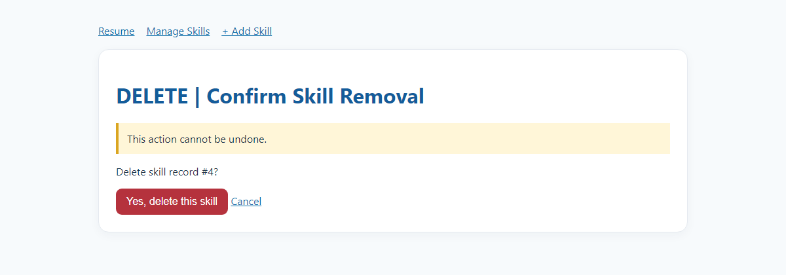 |
| 7 | **DELETE**: ลบแล้วแถวหายไป เหลือ 3 แถวเดิม | 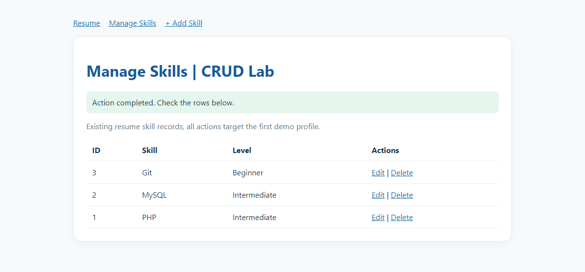 |
| 8 | **Parameter binding**: ข้อความหน้าตาเหมือน SQL injection ถูกเก็บเป็นข้อความธรรมดา ตารางไม่ถูกลบ | 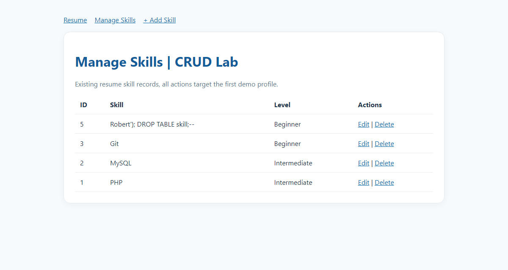 |

ผลตรวจเพิ่มเติม: ส่งฟอร์มโดยไม่มี CSRF token ได้ 403, id ที่ไม่มีอยู่ได้ 404, id ที่ไม่ถูกต้องได้ 400

---

# Week 3: PHP Session Login / Logout

ต่อยอดจาก Resume CRUD Lab เดิม เพิ่มระบบสมัครสมาชิก ล็อกอิน ล็อกเอาต์ และบังคับล็อกอินก่อนเข้าหน้าเรซูเม่/CRUD

## Session คืออะไร

HTTP จำผู้ใช้ไม่ได้ (stateless) PHP จึงเก็บข้อมูลผู้ใช้ไว้ใน **session ฝั่งเซิร์ฟเวอร์** (`$_SESSION`)
แล้วส่งให้เบราว์เซอร์แค่รหัส session ใน cookie `PHPSESSID` ทุกคำขอถัดไปเบราว์เซอร์ส่ง cookie นี้กลับมา
PHP เอารหัสไปหา session ของคนนั้น ข้อมูลสำคัญ (`user_id`, `profile_id`) จึงอยู่บนเซิร์ฟเวอร์ ไม่ได้อยู่ในเบราว์เซอร์

## Flow ล็อกอิน (`login.php`)

1. ฟอร์ม POST พร้อม CSRF token (`auth_csrf`) ถ้าไม่มี token ได้ 403
2. ตรวจรูปแบบอีเมล แล้ว `SELECT id, profile_id, password_hash FROM users WHERE email = ? LIMIT 1`
   ด้วย prepared statement (ค่าอีเมลไม่ถูกต่อเข้า SQL จึงกัน SQL injection)
3. `password_verify($password, $hash)` เทียบกับ hash ใน DB (ตอนสมัครเก็บด้วย `password_hash` เป็น bcrypt ไม่เก็บรหัสจริง)
4. ถ้าถูก: `session_regenerate_id(true)` เปลี่ยนรหัส session ใหม่ (กัน session fixation) แล้วเก็บ `user_id`, `profile_id`, `email`
5. redirect ไป `skills.php`
6. ถ้าผิด: ตอบข้อความเดียวกันคือ "Invalid email or password." ทั้งกรณีอีเมลไม่มีและรหัสผิด ไม่บอกผู้โจมตีว่าอีเมลนี้มีอยู่หรือไม่

## การป้องกันหน้าส่วนตัว

`auth.php` มี `require_login()`: ถ้าไม่มี `$_SESSION['user_id']` จะ redirect ไป `login.php`
`index.php` และ `crud_bootstrap.php` (ที่ทุกหน้า CRUD เรียกใช้) เรียกฟังก์ชันนี้ทุกครั้ง

ข้อมูลของใครของมัน: `profile_id` มาจาก session ไม่ได้มาจากฟอร์ม และทุกคำสั่ง CRUD มี
`WHERE id = ? AND profile_id = ?` ผู้ใช้คนหนึ่งจึงเห็น/แก้/ลบแถวของอีกคนไม่ได้ แม้จะเดา id ถูก

## Flow ล็อกเอาต์ (`logout.php`)

1. กดปุ่มยืนยัน (POST + CSRF token) การเปิดลิงก์เฉย ๆ ไม่ทำให้ล็อกเอาต์
2. `$_SESSION = []` ล้างข้อมูล
3. สั่ง cookie `PHPSESSID` หมดอายุ
4. `session_destroy()` ทำลาย session บนเซิร์ฟเวอร์
5. redirect ไป `login.php?logged_out=1`

เพราะ session ถูกทำลายบนเซิร์ฟเวอร์ แม้เบราว์เซอร์ส่ง cookie เก่ากลับมา (กด Back / refresh) ก็เข้าหน้าส่วนตัวไม่ได้

## ผลทดสอบ (36 ข้อผ่านทั้งหมด)

ทดสอบบน XAMPP (Apache + MariaDB) ฐานฝึก `resume_lab` ด้วยสคริปต์ที่ส่งฟอร์มจริงพร้อม CSRF token
แล้วตรวจผลจากการตอบกลับของ Apache และจากตารางใน MySQL โดยตรง ภาพเป็นหน้าเว็บที่เซิร์ฟเวอร์ตอบกลับจริง

| กรณีทดสอบใน README | ผล | ภาพ |
|---|---|---|
| 1. ไม่ล็อกอินแล้วเปิด `skills.php`, `index.php`, create/edit/delete | redirect ไป `login.php` ทุกหน้า | 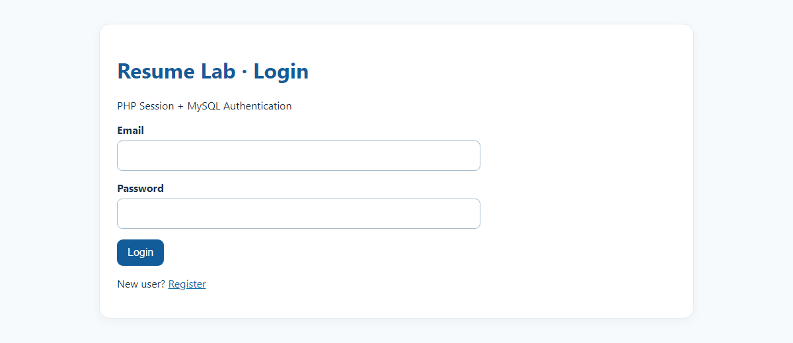 |
| 2. สมัครสมาชิก (รหัสผ่านสั้นกว่า 10 ตัว/อีเมลซ้ำถูกปฏิเสธ) | สมัครได้ รหัสผ่านเก็บเป็น bcrypt (`$2y$`, 60 ตัวอักษร) | 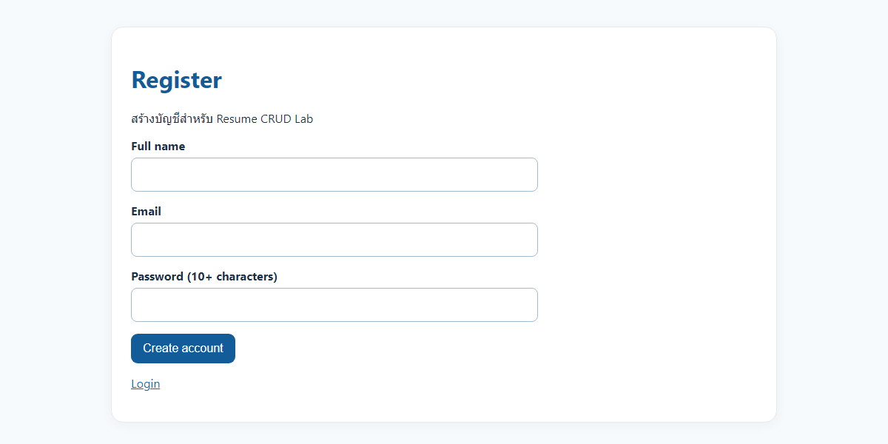 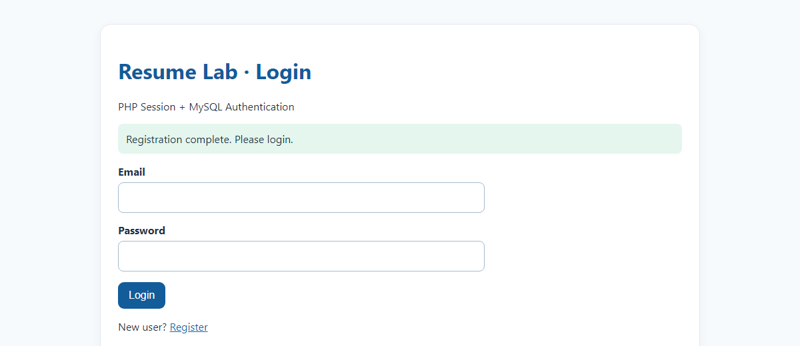 |
| 2. รหัสผ่านผิดล็อกอินไม่ได้ / รหัสถูกล็อกอินได้ | ผิดได้ข้อความ error, ถูก redirect ไป `skills.php` และรหัส session เปลี่ยน | 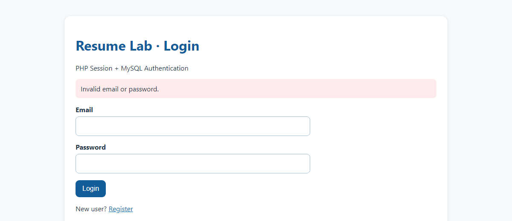 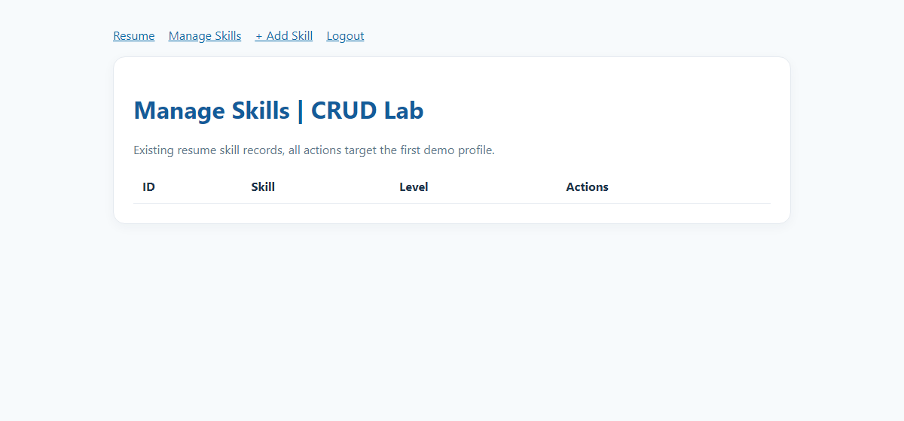 |
| 3. ล็อกเอาต์แล้วเข้าหน้าส่วนตัวไม่ได้ แม้ใช้ cookie เก่า | cookie เก่าถูก redirect ไป `login.php` | 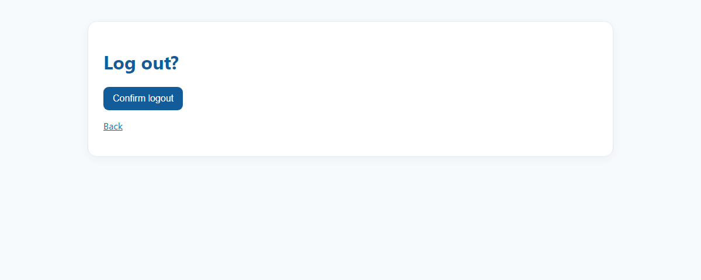 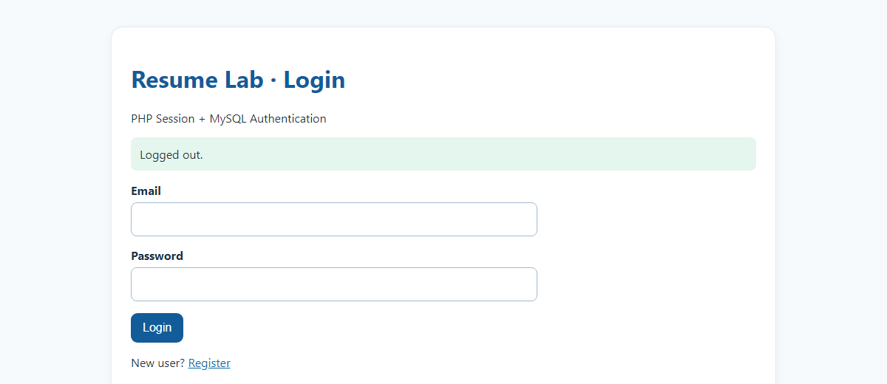 |
| 4. ผู้ใช้สองคนไม่เห็น/แก้/ลบข้อมูลของกัน | B เห็นตารางว่าง, เปิดหน้าแก้ของ A ได้ 404, สั่งลบ skill ของ A แล้วแถวยังอยู่ | 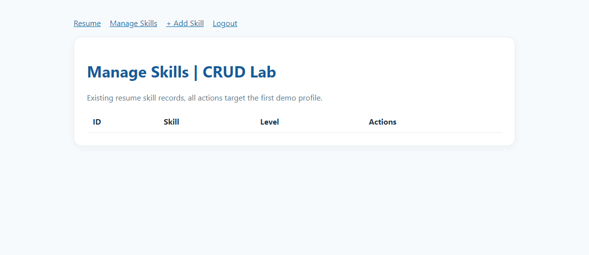 |
| 5. สร้าง แก้ ลบ หลังล็อกอิน | ทำงานถูกต้องทั้งสามขั้น | 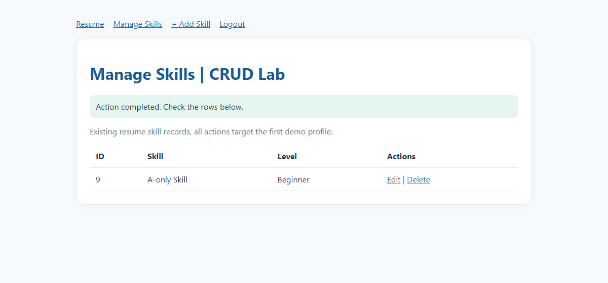 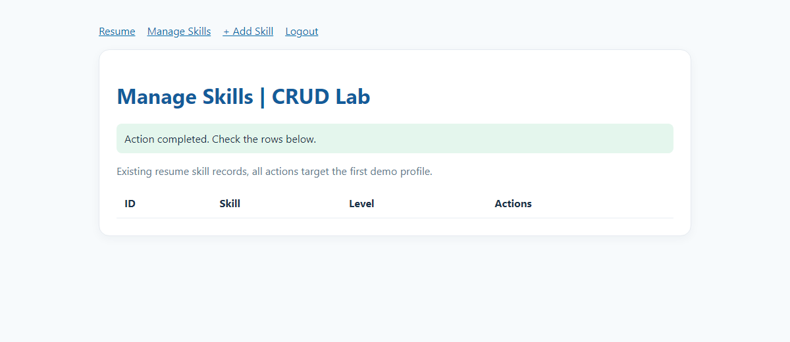 |
| 5. หน้าเรซูเม่ของผู้ใช้ใหม่ | แสดงเฉพาะข้อมูลของตัวเอง ไม่มี PHP error | 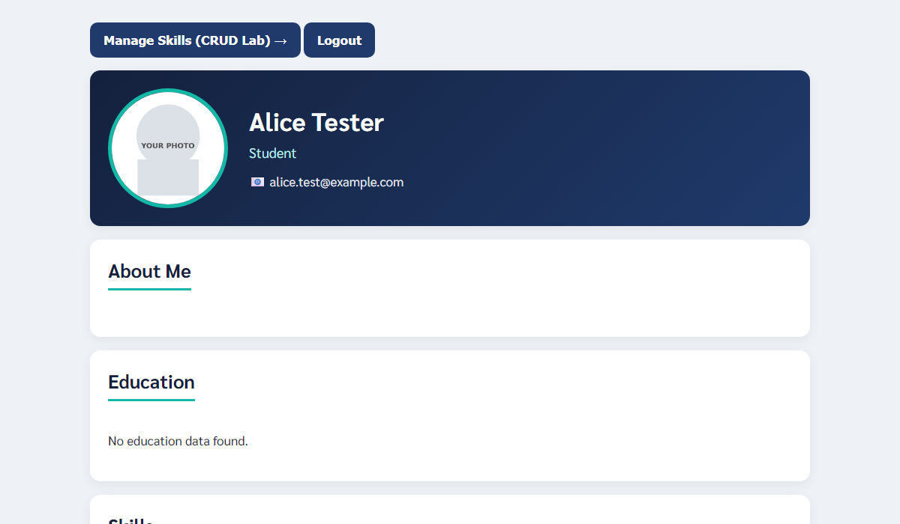 |
| 6. ใส่ SQL injection ในช่องอีเมล/รหัสผ่าน | ล็อกอินไม่ผ่าน ไม่มี error | (อยู่ในผลสคริปต์) |
| 7. repo ไม่มีรหัสผ่านจริงหรือ `.env` | ไม่มี (`.gitignore` กัน `.env` และ `secret/`) | |

เพิ่มเติม: ส่งฟอร์มล็อกอิน/ล็อกเอาต์โดยไม่มี CSRF token ได้ 403

## ข้อจำกัดที่ทราบ

- ยังไม่มีการจำกัดจำนวนครั้งที่ล็อกอินผิด (throttling), session timeout, การบังคับ HTTPS หรือการยืนยันอีเมล ตามที่ README ระบุว่าระบบจริงต้องมีเพิ่ม
- หน้าสมัครสมาชิกเปิดให้ใครก็สมัครได้ ถ้านำขึ้นเว็บสาธารณะ ควรปิดหรือจำกัดหลังสาธิตเสร็จ
